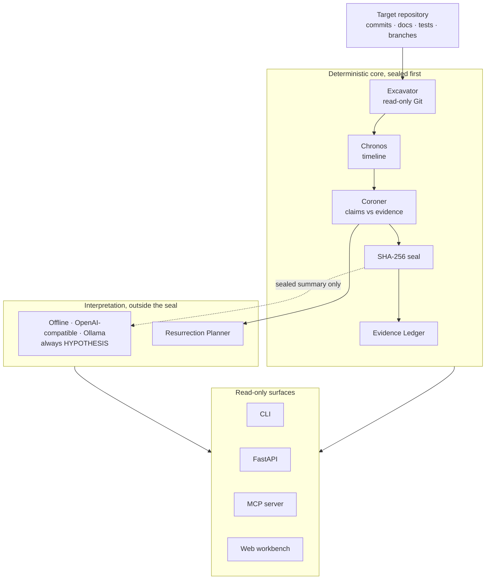

# NECROMANCER

**Resurrect the investigation. Not the assumptions.**

English · [Español](README_ES.md) · [Technical README](docs/ARCHITECTURE.md)

---

### The problem

You open a project you abandoned eight months ago. Four hundred files, contradictory notes, tests that no longer run, three documents claiming everything is finished. What were you trying to do? What did you actually prove? What is still pending? Which claims can no longer be trusted?

NECROMANCER rebuilds the history of a project from its digital remains. It is not a chatbot that summarizes a repository. It is an archaeologist for projects.

### What it does

1. **Repository autopsy.** It reads the Git history, documentation and tests without modifying anything, and rebuilds a timeline where every event links back to its file and commit.
2. **Reconstruction of intentions.** It proposes competing hypotheses about abandoned goals and decisions. Every hypothesis keeps its origin and its uncertainty. It never presents a single invented story as the story.
3. **False-conclusion detector.** It finds claims such as "implemented", "fixed" or "verified" and checks them against the available evidence.
4. **Resurrection plan.** It produces a path to resume the project: what to check first, what knowledge is missing, which risks are still open, and which next steps are reversible.

This is the difference it aims for:

> The README states the vulnerability was fixed on June 14. The associated commit modifies the validator, but no corresponding regression test was found. Status: fix documented, verification not demonstrated.

### How it works



The target repository is untrusted data: never executed, never treated
as instructions. Models are interchangeable investigators and can never
change a verdict. Full architecture: [Technical README](docs/ARCHITECTURE.md).

### The promise

- No model-generated inference silently becomes a verified historical fact.
- Missing evidence is never treated as proof that something did not happen.
- Everything it states points to the evidence it came from.
- It would rather say "not determinable" than invent certainty.

### Status

NECROMANCER is built in levels toward its full destination. Each level is complete and usable on its own; nothing is a throwaway prototype. What works today and what is still missing are listed honestly in [docs/STATUS.md](docs/STATUS.md). Known limits are documented, not hidden.

### Quick start

```bash
pip install -e .
necromancer excavate /path/to/abandoned-repo --out report.json --markdown report.md
```

The target repository is only read. Its code is never executed.

### Run the workbench locally

First time only, from the repository root:

```bash
cd necromancer
python3 -m venv .venv
source .venv/bin/activate
pip install -e ".[dev]"
cd frontend
npm install
cd ..
```

Every time you want to use it, open two terminals.

Terminal 1, the API (from the repository root, virtualenv active):

```bash
source .venv/bin/activate
uvicorn necromancer.api:app --port 8000
```

Terminal 2, the interface:

```bash
cd frontend
npm run dev
```

Then open http://localhost:5173 in your browser and investigate.

If port 8000 or 5173 is already taken on your machine, use free ones
instead and tell the interface where the API went. Terminal 1:
`uvicorn necromancer.api:app --port 8765`. Terminal 2:
`VITE_API_BASE=http://127.0.0.1:8765 npm run dev -- --port 5174`.
Then open http://localhost:5174.

To stop it, press Ctrl+C in both terminals.

As an MCP server, for external clients that do their own reasoning:

```bash
necromancer-mcp
```

Language models are optional and interchangeable (offline mode,
OpenAI-compatible APIs, local Ollama). None is required, and none can
change a verdict.

### Round 4: epistemic calibration

Contradictions are now qualified. CONFIRMED means a defensible
incompatibility in the same subject, scope and time; everything weaker
is a POTENTIAL conflict for human review and changes no verdict. A
generic TODO in an unrelated file can no longer contradict a fix, a
planned feature cannot be "contradicted" by today's code, and a project
is only called explicitly abandoned when its own root README currently
says so. How this is measured, with the failures left in the open:
[docs/EPISTEMIC-CALIBRATION.md](docs/EPISTEMIC-CALIBRATION.md). Run the
calibration benchmark any time with
`python benchmarks/round4/run_calibration.py`, and the synthetic scale
harness with `python scripts/scale_benchmark.py`.

Round 5 then attacked that result with a fresh, frozen evaluation set
it had never seen, real-repository adjudication, a full stress test on
a 1,247-commit repository, and a real browser run. It found and fixed
six more ways to fabricate a contradiction — and recorded the two kinds
it still honestly misses. Details:
[docs/EPISTEMIC-CALIBRATION.md](docs/EPISTEMIC-CALIBRATION.md) and
[docs/REDTEAM-ROUND5.md](docs/REDTEAM-ROUND5.md).

### License

Apache-2.0. See [LICENSE](LICENSE).
