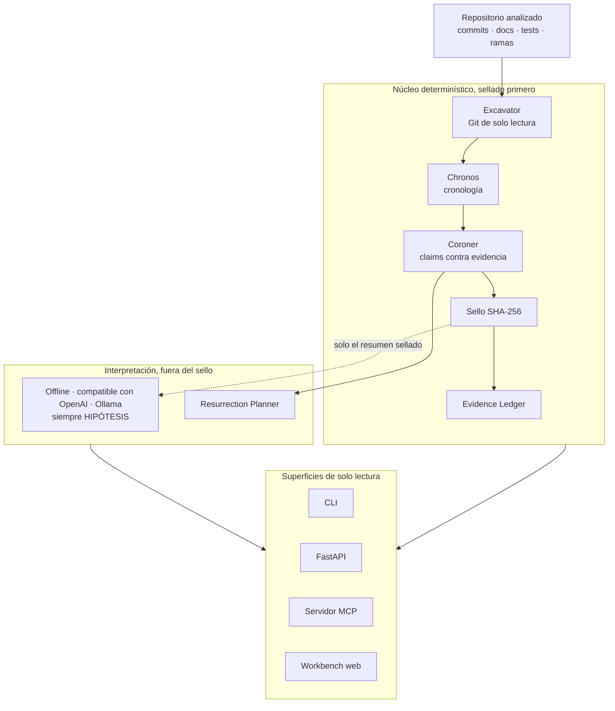

# NECROMANCER

**Resurrect the investigation. Not the assumptions.**

[English](README.md) · Español · [Technical README](docs/ARCHITECTURE.md)

---

### El problema

Abrís un proyecto que abandonaste hace ocho meses. Cuatrocientos archivos, notas contradictorias, tests que ya no corren, tres documentos que afirman que todo está terminado. ¿Qué estabas intentando hacer? ¿Qué llegaste a demostrar de verdad? ¿Qué quedó pendiente? ¿Qué afirmaciones ya no son confiables?

NECROMANCER reconstruye la historia de un proyecto a partir de sus restos digitales. No es un chatbot que resume un repositorio. Es un arqueólogo de proyectos.

### Qué hace

1. **Autopsia del repositorio.** Lee el historial Git, la documentación y las pruebas sin modificar nada, y reconstruye una cronología donde cada evento enlaza con su archivo y su commit.
2. **Reconstrucción de intenciones.** Propone hipótesis en competencia sobre objetivos y decisiones abandonados. Cada hipótesis conserva su procedencia y su incertidumbre. Nunca presenta una única historia inventada como si fuera la historia.
3. **Detector de falsas conclusiones.** Encuentra afirmaciones como «implementado», «corregido» o «verificado» y las contrasta con la evidencia disponible.
4. **Plan de resurrección.** Produce una ruta para retomar el proyecto: qué comprobar primero, qué conocimiento falta recuperar, qué riesgos siguen abiertos y cuáles son las próximas acciones reversibles.

Esta es la diferencia que busca:

> El README afirma que la vulnerabilidad fue corregida el 14 de junio. El commit asociado modifica el validador, pero no se encontró una prueba de regresión correspondiente. Estado: corrección documentada, verificación no demostrada.

### Cómo funciona



El repositorio analizado es dato no confiable: nunca se ejecuta y nunca
se trata como instrucciones. Los modelos son investigadores
intercambiables y jamás pueden cambiar un veredicto. Arquitectura
completa: [Technical README](docs/ARCHITECTURE.md).

### La promesa

- Ninguna inferencia generada por un modelo se convierte en silencio en un hecho histórico verificado.
- La ausencia de evidencia nunca se trata como prueba de que algo no ocurrió.
- Todo lo que afirma apunta a la evidencia de la que salió.
- Prefiere decir «no determinable» antes que inventar certeza.

### Estado

NECROMANCER se construye por niveles hacia su destino completo. Cada nivel es completo y utilizable por sí mismo; nada es un prototipo descartable. Lo que funciona hoy y lo que todavía falta se listan con honestidad en [docs/STATUS.md](docs/STATUS.md). Los límites conocidos se documentan, no se esconden.

### Inicio rápido

```bash
pip install -e .
necromancer excavate /ruta/al-repo-abandonado --out report.json --markdown report.md
```

El repositorio analizado solo se lee. Su código nunca se ejecuta.

### Levantar el workbench en tu máquina

Solo la primera vez, desde la raíz del repositorio:

```bash
cd necromancer
python3 -m venv .venv
source .venv/bin/activate
pip install -e ".[dev]"
cd frontend
npm install
cd ..
```

Cada vez que quieras usarlo, abrí dos terminales.

Terminal 1, la API (desde la raíz del repositorio, con el entorno activo):

```bash
source .venv/bin/activate
uvicorn necromancer.api:app --port 8000
```

Terminal 2, la interfaz:

```bash
cd frontend
npm run dev
```

Después abrí http://localhost:5173 en tu navegador e investigá.

Si el puerto 8000 o el 5173 ya están ocupados en tu máquina, usá puertos
libres y avisale a la interfaz dónde quedó la API. Terminal 1:
`uvicorn necromancer.api:app --port 8765`. Terminal 2:
`VITE_API_BASE=http://127.0.0.1:8765 npm run dev -- --port 5174`.
Y abrí http://localhost:5174.

Para apagarlo, Ctrl+C en las dos terminales.

Como servidor MCP, para clientes externos que razonan por su cuenta:

```bash
necromancer-mcp
```

Los modelos de lenguaje son opcionales e intercambiables (modo offline,
APIs compatibles con OpenAI, Ollama local). Ninguno es obligatorio y
ninguno puede cambiar un veredicto.

### Ronda 4: calibración epistémica

Las contradicciones ahora vienen calificadas. CONFIRMED significa una
incompatibilidad defendible en el mismo tema, alcance y momento; todo lo
más débil es un conflicto POTENTIAL para revisión humana y no cambia
ningún veredicto. Un TODO genérico en un archivo no relacionado ya no
puede contradecir una corrección, una funcionalidad planificada no puede
quedar "contradicha" por el código de hoy, y un proyecto solo se declara
explícitamente abandonado cuando su propio README raíz lo dice hoy.
Cómo se mide esto, con los fallos a la vista:
[docs/EPISTEMIC-CALIBRATION.md](docs/EPISTEMIC-CALIBRATION.md). El
benchmark de calibración se corre con
`python benchmarks/round4/run_calibration.py` y el harness de escala
sintética con `python scripts/scale_benchmark.py`.

La Ronda 5 atacó ese resultado con un set de evaluación nuevo y
congelado que el sistema nunca había visto, adjudicación sobre repos
reales, un stress test completo sobre un repositorio de 1.247 commits
y una corrida en navegador real. Encontró y corrigió seis formas más
de fabricar una contradicción, y registró las dos clases que todavía
pierde honestamente. Detalle:
[docs/EPISTEMIC-CALIBRATION.md](docs/EPISTEMIC-CALIBRATION.md) y
[docs/REDTEAM-ROUND5.md](docs/REDTEAM-ROUND5.md).

### Licencia

Apache-2.0. Ver [LICENSE](LICENSE).
