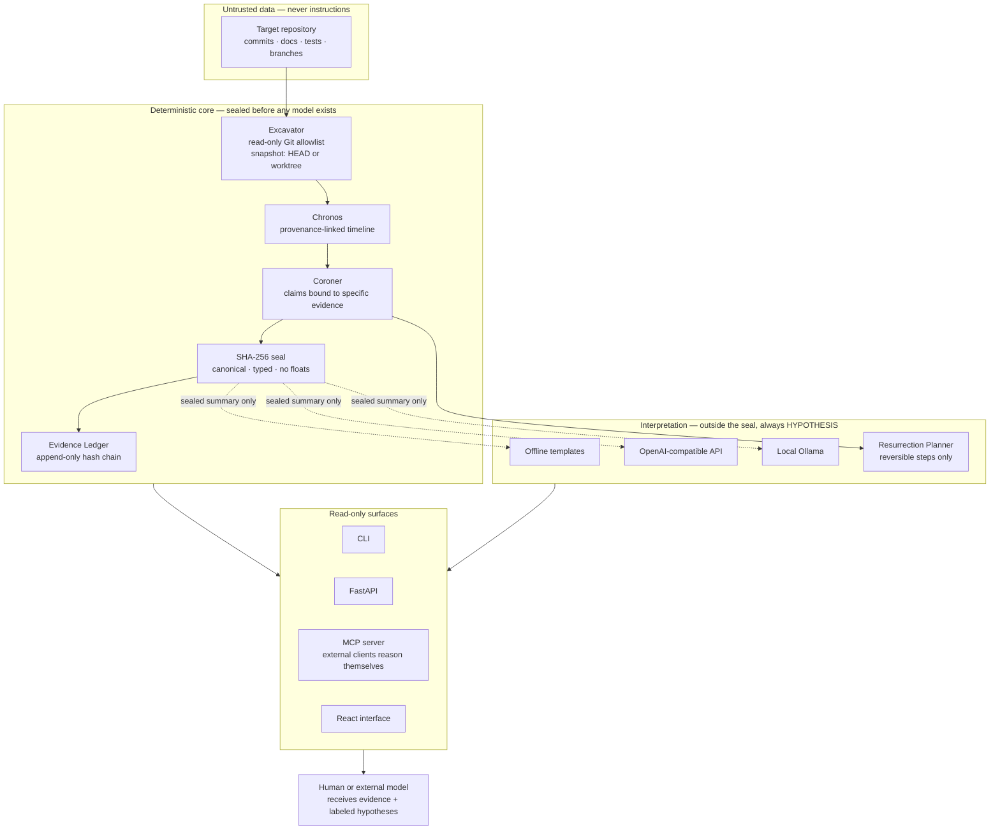

# Architecture

NECROMANCER is an evidence engine. Language models are interchangeable
investigators, never epistemic authorities.

Rules that the diagram encodes:

- The target repository is data. Its files and commit messages are never
  executed and never treated as instructions.
- Claim states are computed deterministically and sealed. A provider may
  only add `HYPOTHESIS` rows beside the seal; swapping providers changes
  wording, never a verdict.
- The MCP server exposes the same deterministic evidence to external
  clients so they can reason themselves. It calls no model and uses no
  sampling.
- Every surface is read-only with respect to the target repository.
