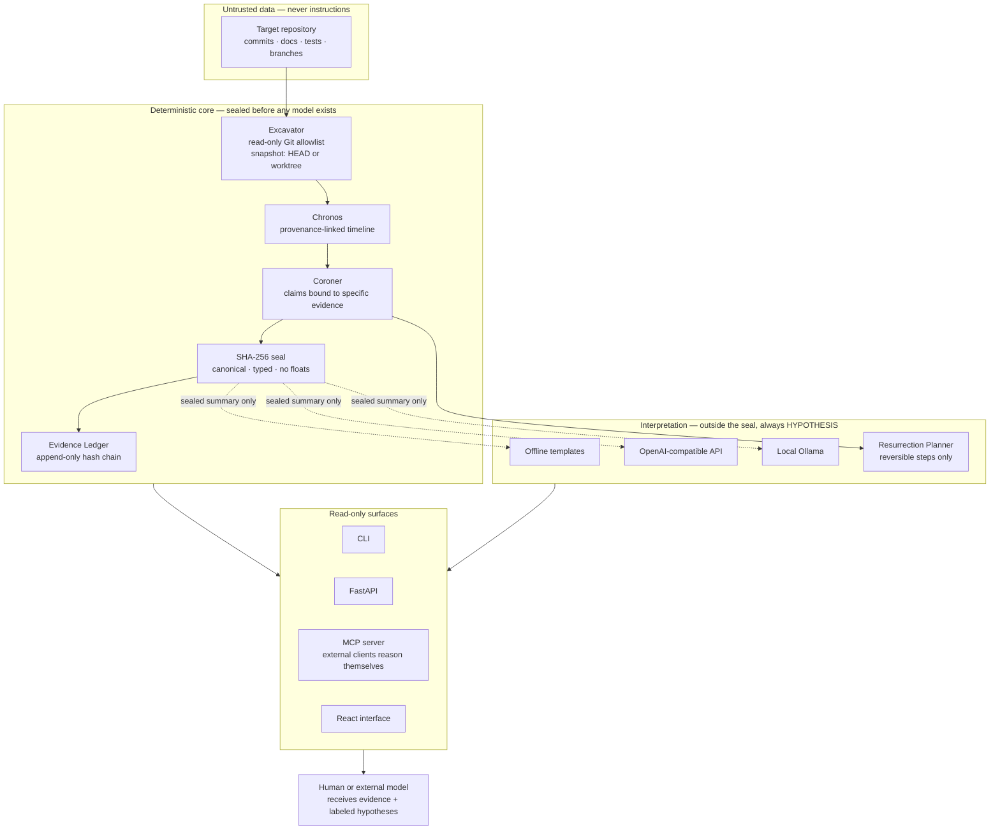

# Architecture

NECROMANCER is an evidence engine. Language models are interchangeable
investigators, never epistemic authorities.

See also: [THREAT_MODEL.md](THREAT_MODEL.md) for trust boundaries and
[STATUS.md](STATUS.md) for the completed/incomplete inventory.

## Workbench layers added in Round 3

- **Acquisition** (`acquire.py`): only `https://github.com/<owner>/<repo>`
  is accepted, cloned bounded (depth 500, 200 MB, no checkout, no
  submodules, no credentials) into an isolated workspace. Acquisition
  failures are errors, never findings, and the footprint is recorded.
- **Persistence** (`workspace.py`): SQLite investigation store keyed by
  seal. Reopening never rewrites stored evidence; a changed HEAD reports
  `STALE`. Snapshots can be compared at claim level and exported as a
  manifest.
- **Health** (`health.py`): observable indicators (recency, branches,
  TODO/FIXME, tests, CI config, tags, explicit maintenance statements)
  with a category that inactivity alone can never raise to abandoned.
- **Evidence graph** (`graph.py`): typed projection (`SUPPORTED_BY`,
  `CONTRADICTED_BY`, `INTRODUCED_IN`, `MODIFIED_IN`, `REFERENCES`,
  `HYPOTHESIZED_CAUSE`, `REQUIRES_VERIFICATION`). Speculative edges are
  labeled; the graph is never the source of truth.
- **Verification bundle** (`scripts/verify_bundle.py`): stdlib-only
  checker for report provenance and ledger chain integrity, independent
  of the producing code.

Rules that the diagram encodes:

- The target repository is data. Its files and commit messages are never
  executed and never treated as instructions.
- Claim states are computed deterministically and sealed. A provider may
  only add `HYPOTHESIS` rows beside the seal; swapping providers changes
  wording, never a verdict.
- The MCP server exposes the same deterministic evidence to external
  clients so they can reason themselves. It calls no model and uses no
  sampling.
- Every surface is read-only with respect to the target repository.
